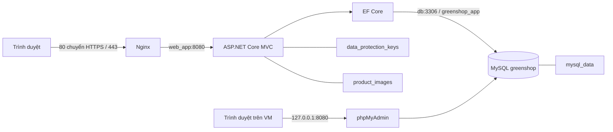

# GreenShop — Đề tài số 9: Website thương mại điện tử

Đồ án môn **Triển khai và Quản trị Hệ thống Phần mềm**. Sinh viên: **Đặng Quốc Trung**, MSSV **DTC245200016**, ICTU.

GreenShop bán cây cảnh và vật tư làm vườn. M1 gồm ứng dụng ASP.NET Core MVC, MySQL, phpMyAdmin, Docker Compose và Nginx HTTPS. Chức năng và giao diện hiện có được giữ nguyên khi hoàn thiện hạ tầng.

## 1. Chức năng hiện có

| Khách hàng | Quản trị viên |
|---|---|
| Trang chủ với sản phẩm tự trượt/kéo bằng chuột; danh mục, tìm kiếm, chi tiết sản phẩm | Sản phẩm, danh mục và upload ảnh |
| Đăng ký/đăng nhập, giỏ hàng theo tài khoản, mua ngay, đặt hàng | Quản lý người dùng, vai trò, khóa tài khoản và thu hồi phiên |
| COD, VietQR chuyển khoản **xác nhận thủ công**, phí vận chuyển | Vòng đời đơn hàng, kiểm soát tồn kho, ghi chú và lịch sử thao tác |
| Lịch sử/chi tiết đơn riêng của mình | Dashboard từ dữ liệu thật, biểu đồ tương tác, xuất Excel |
| Trạng thái chuyển khoản và đơn hàng | Cài đặt ngân hàng, phí ship và ngưỡng miễn phí ship |

VietQR không tự xác minh giao dịch ngân hàng. Khách báo đã chuyển khoản không làm đơn thành “Đã thanh toán”; Admin kiểm tra giao dịch rồi xác nhận. Giá trị đơn đã giao trên Dashboard gồm phí ship đã lưu, nhóm theo ngày đặt hàng GMT+7; không đồng nghĩa doanh thu thực thu/lợi nhuận.

## 2. Công nghệ và kiến trúc

| Thành phần | Công nghệ |
|---|---|
| Web | .NET 8, ASP.NET Core MVC, Razor; Bootstrap, Font Awesome, font Be Vietnam Pro phục vụ nội bộ |
| Truy cập dữ liệu | EF Core 8, Pomelo MySQL, migrations |
| Database / quản trị | MySQL 8 / phpMyAdmin |
| Triển khai | Docker Engine, Docker Compose plugin |
| Reverse proxy / HTTPS | Nginx, chứng chỉ tự ký; OpenSSL tạo chứng chỉ |



Bốn service là `db`, `web_app`, `nginx`, `phpmyadmin`, kết nối bằng Docker DNS trong `app_net`. Nginx phân giải lại `web_app` khi IP container đổi; không dùng IP container cố định. `resolve` trong upstream cần Nginx từ **1.27.3**; kiểm tra version nếu dùng image khác.

## 3. Cấu trúc thư mục

```text
.
├── backend/
│   ├── .dockerignore
│   └── GreenShop.Web/
│       ├── Areas/Admin/           # Controller/View quản trị
│       ├── Controllers/           # Storefront, giỏ hàng, thanh toán, tài khoản
│       ├── Data/                  # DbContext và danh sách ngân hàng
│       ├── Migrations/            # Lịch sử schema EF Core
│       ├── Models/, Services/, ViewComponents/, Views/
│       ├── wwwroot/               # CSS, JS, font và thư viện giao diện
│       ├── Dockerfile             # Dockerfile thực tế, context ./backend
│       └── GreenShop.Web.csproj
├── nginx/
│   ├── default.conf              # Cấu hình thực tế mount vào conf.d
│   └── ssl/                      # cert.pem/key.pem tạo tại môi trường, không tracked
├── scripts/                      # HTTPS và bootstrap tài khoản triển khai
├── tests/                        # Hồi quy và nghiệm thu, không cần để phục vụ web
├── docs/evidence/commit1/         # Minh chứng M1 đã loại thông tin nhạy cảm
├── .env.example
├── .gitignore
├── docker-compose.yml
└── README.md
```

Không sử dụng `backend/Dockerfile` hay `nginx/nginx.conf` cũ ở cổng 3000; các file legacy đó đã được loại bỏ sau khi kiểm tra tham chiếu.

## 4. Điều kiện chạy

- Ubuntu/Linux; Docker Engine và Docker Compose **plugin** (`docker compose`, không phải `docker-compose` cũ).
- Git, OpenSSL và Python 3 (thư viện chuẩn dùng cho script triển khai).
- Cổng 80/443 còn trống; dung lượng đủ để tải image/build. Khi nghiệm thu VM còn khoảng 20 GiB trống.
- .NET SDK 8 chỉ cần khi build/kiểm thử ngoài Docker; chạy web bằng Compose không cần cài SDK trên host.
- Xác định IP thật bằng `ip -brief -4 address`. IP có thể đổi sau khi đổi mạng VMware/DHCP.

| Cổng host | Binding | Mục đích |
|---|---|---|
| 80 / 443 | Host | Nginx là điểm truy cập website từ Windows/VM |
| 8080 | `127.0.0.1` | phpMyAdmin trên VM; không truy cập trực tiếp bằng IP VM từ Windows |
| 3306 | `127.0.0.1` | MySQL cho công cụ cục bộ; web dùng `db:3306` nội bộ |
| 5000 | `127.0.0.1` | Backend chẩn đoán cục bộ; trình duyệt dùng HTTPS qua Nginx |

## 5. Triển khai từ bản clone mới

```bash
git clone https://github.com/dtc245200016/GreenShop.git
cd GreenShop
cp .env.example .env
chmod 600 .env
openssl rand -hex 32
openssl rand -hex 32
```

Sửa `.env`: đặt hai giá trị sinh ngẫu nhiên **khác nhau** cho `MYSQL_ROOT_PASSWORD` và `MYSQL_APP_PASSWORD`. Mỗi giá trị hex có 64 ký tự. Không giữ placeholder, không đưa mật khẩu lên Git hoặc ảnh báo cáo. Database cố định là `greenshop`; user ứng dụng là `greenshop_app`.

Tạo chứng chỉ với IP hoặc hostname sẽ dùng trong trình duyệt:

```bash
ip -brief -4 address
bash scripts/generate-dev-cert.sh <IP_HOAC_HOSTNAME_THUC_TE>
docker compose config --quiet
docker compose build web_app
docker compose up -d --wait --wait-timeout 120 db
bash scripts/bootstrap-db-user.sh
docker compose up -d --wait --wait-timeout 120
```

Thay `<IP_HOAC_HOSTNAME_THUC_TE>` bằng giá trị thật; **không nhập dấu `< >`**. Ví dụ IP quan sát tại lần nghiệm thu là `192.168.197.128`, không phải IP bắt buộc của cấu hình.

MySQL tạo database và app user khi volume còn rỗng. `bootstrap-db-user.sh` cũng hỗ trợ volume đã có: xác minh/tạo `greenshop_app`, cấp quyền trong đúng schema, không đổi mật khẩu root, không sửa bảng nghiệp vụ, không reset schema. Nếu app user đã tồn tại nhưng mật khẩu/quyền không khớp, script dừng; không tự thay mật khẩu hoặc thu hồi quyền của tài khoản đó.

Lần đầu với bảng `Users` **rỗng**, tạo Admin bằng công cụ triển khai:

```bash
bash scripts/create-initial-admin.sh
```

Công cụ hỏi tên/email/mật khẩu qua terminal, giấu mật khẩu và lưu bcrypt; không có tài khoản/mật khẩu mặc định. Nó từ chối khi đã có bất kỳ User nào, không sửa role/password hiện có. Vì vậy tạo Admin **trước khi đăng ký khách hàng** trên bản cài mới. Với hệ thống đã có người dùng, dùng Admin hiện hữu, không chạy lại công cụ này.

Mở:

- Website: `https://<IP_VM>/` hoặc hostname đúng SAN. Đăng nhập Admin tại `/Admin/Account/Login`; khách hàng tại `/Account/Login`.
- Trên trình duyệt **của VM**: `http://127.0.0.1:8080/` để dùng phpMyAdmin. Server là `db`; đăng nhập thủ công bằng `greenshop_app` và mật khẩu app trong `.env`, hoặc root khi cần quản trị. Không có auto-login/bypass authentication.
- Bản cài mới chưa có sản phẩm: Admin tạo danh mục/sản phẩm và upload ảnh bằng web. Không seed doanh thu/đơn hàng giả.

### Truy cập phpMyAdmin từ Windows

Phương án mặc định đã nghiệm thu là trình duyệt trên VM. Nếu cần từ Windows, dùng OpenSSH và tài khoản SSH thật của VM:

```powershell
ssh -N -L 18080:127.0.0.1:8080 trung@<IP_VM>
```

Giữ terminal mở rồi truy cập `http://127.0.0.1:18080/` trên Windows. Cần SSH của VM đang hoạt động và chứng thực được. Kiểm thử xuyên từ máy Windows cần thực hiện tại máy đó; không coi việc cổng 22 mở là bằng chứng tunnel đã hoạt động. Không mở MySQL/phpMyAdmin ra mọi giao diện để xử lý một lỗi tunnel.

### Cập nhật hệ thống đã có

Sao lưu trước; giữ nguyên mật khẩu root của volume đã khởi tạo. Bổ sung `MYSQL_APP_PASSWORD` riêng vào `.env`, build, chờ DB hiện tại healthy, chạy bootstrap, rồi cập nhật:

```bash
docker compose config --quiet
docker compose build web_app
bash scripts/bootstrap-db-user.sh
docker compose up -d --wait --wait-timeout 120
```

Đổi `.env` không tự đổi mật khẩu trong MySQL đã có dữ liệu. Khi Compose thay cấu hình container, named volumes vẫn được giữ; không dùng `down -v`, không prune volume và không reset migration history.

## 6. Database, migrations và dữ liệu bền vững

Web áp dụng `Database.Migrate()` **trước khi mở cổng phục vụ**. Sáu migrations hiện có tạo schema và cấu hình vận chuyển ban đầu; không có seed User/sản phẩm/đơn hàng. Không cần chạy SQL khởi tạo lại trên database đang dùng.

`greenshop_app` có quyền trong **`greenshop.*`**, gồm DDL để startup migrations hoạt động; không có quyền quản trị user/server hoặc đọc `mysql.user`. Đây chưa phải runtime user chỉ có DML. Tách migration credentials khỏi runtime và thu hẹp DDL là hạng mục hardening tiếp theo.

Kiểm tra chỉ đọc:

```bash
docker compose exec -T db sh -c 'MYSQL_PWD="$MYSQL_ROOT_PASSWORD" mysql -uroot --database="$MYSQL_DATABASE" -e "SHOW TABLES; SELECT MigrationId FROM __EFMigrationsHistory ORDER BY MigrationId;"'
```

Schema gồm `Users`, `Categories`, `Products`, `CartItems`, `Orders`, `OrderItems`, `OrderStatusHistories`, `PaymentShippingSettings` và `__EFMigrationsHistory`.

| Volume | Dữ liệu | Mount trong container |
|---|---|---|
| `mysql_data` | MySQL, schema và records | `/var/lib/mysql` |
| `data_protection_keys` | Key ring cho cookie/CSRF/TempData | `/app/keys` |
| `product_images` | Ảnh upload và ảnh còn được đơn cũ tham chiếu | `/app/wwwroot/uploads/products` |

Tên volume thực tế có prefix project Compose. Giữ cùng project/thư mục khi cập nhật; kiểm tra `docker volume ls`/`docker inspect` trước khi đổi project name. Không xoá key ring để “sửa đăng nhập”.

Sao lưu database vào thư mục riêng ngoài repository:

```bash
backup_dir="$HOME/greenshop-backups"
mkdir -p "$backup_dir"
chmod 700 "$backup_dir"
umask 077
docker compose exec -T db sh -c 'MYSQL_PWD="$MYSQL_ROOT_PASSWORD" exec mysqldump -uroot --single-transaction --no-tablespaces --set-gtid-purged=OFF greenshop' > "$backup_dir/greenshop-$(date +%Y%m%d-%H%M%S).sql"
```

Backup chứa dữ liệu tài khoản/khách hàng, phải giữ riêng và không commit. Đồng thời có phương án lưu an toàn hai volume keys/images trước khi chuyển host; không restore đè vào hệ thống đang chạy chỉ để kiểm thử.

## 7. HTTPS tự ký

Script nhận IP/DNS, ghi SAN đúng loại, bổ sung loopback để kiểm tra cục bộ, sinh RSA-2048/SHA-256 và key mode `600`. Mặc định **từ chối ghi đè** bất kỳ cert/key hiện có. Chỉ khi chủ động đổi địa chỉ/gia hạn:

```bash
bash scripts/generate-dev-cert.sh <DIA_CHI_MOI> --force
docker compose exec nginx nginx -t
docker compose exec nginx nginx -s reload
```

Chứng chỉ đang dùng tại nghiệm thu có SAN đúng IP VM và được giữ nguyên. Tự ký gây cảnh báo trình duyệt vì không có CA tin cậy; kiểm tra fingerprint/chứng chỉ trước khi chấp nhận trong môi trường đồ án. Không sử dụng chứng chỉ này cho TLS public production. Khi truy cập localhost với chứng chỉ cũ chỉ có IP VM, cảnh báo sai SAN là đúng; dùng địa chỉ khớp SAN.

```bash
openssl x509 -in nginx/ssl/cert.pem -noout -subject -dates -ext subjectAltName
openssl x509 -in nginx/ssl/cert.pem -noout -checkip <IP_VM>
```

Không chia sẻ `key.pem`; cert/key runtime đều bị `.gitignore` loại khỏi Git. Nginx dùng TLS 1.2/1.3, không thêm CSP hoặc HSTS mạnh làm khó demo tự ký.

## 8. Xác minh sau triển khai

```bash
docker compose config --quiet
docker compose ps
docker compose exec nginx nginx -v
docker compose exec nginx nginx -t
curl -I http://<IP_VM>/
curl -kI https://<IP_VM>/
curl --cacert nginx/ssl/cert.pem -I https://<IP_VM>/
curl -k https://<IP_VM>/health/ready
curl -I http://127.0.0.1:8080/
docker compose exec web_app dotnet GreenShop.Web.dll --healthcheck
docker compose logs --tail=50 web_app nginx db
```

Kỳ vọng: bốn service running/healthy; HTTP 301 giữ path/query sang HTTPS; trang chủ HTTPS 200; readiness `ready`; phpMyAdmin hiển thị login và xem được DB sau đăng nhập; không 502/redirect loop. `-k` chỉ phục vụ kiểm thử cert tự ký tại môi trường này; lệnh `--cacert` kiểm tra trust/SAN đúng thật.

Headers HTTPS: `X-Frame-Options: SAMEORIGIN`, `X-Content-Type-Options: nosniff`, `Referrer-Policy: strict-origin-when-cross-origin`; Nginx không công bố version. Web readiness truy vấn `SELECT 1`; CLI probe trong container trả nonzero khi DB/web không sẵn sàng. Nginx probe kiểm tra HTTPS → web → DB. phpMyAdmin probe kiểm tra HTTP; kết nối SQL được xác minh riêng sau đăng nhập.

Thử recreate **chỉ web** trong khoảng có thể chịu gián đoạn ngắn:

```bash
docker compose up -d --no-deps --no-build --pull never --force-recreate --wait --wait-timeout 120 web_app
curl -kI https://<IP_VM>/
```

Không restart Nginx để che lỗi stale upstream; xác nhận Nginx tự phân giải IP mới. Không recreate/xóa DB chỉ để thử proxy.

## 9. Kiểm thử và minh chứng

`tests/` là công cụ phát triển, không phải dependency phục vụ web. **Đọc script trước khi chạy**: một số test viết dữ liệu, không được chạy tất cả lên `greenshop` thật. Các business tests dùng Compose/MySQL QA riêng, dữ liệu synthetic và ảnh/keys riêng; production chỉ đọc.

Nghiệm thu M1 dùng `tests/m1_acceptance.py`; kết quả công khai đã loại secrets ở [minh chứng Commit 1](docs/evidence/commit1/commit1-verification.md). Backup, cookies, credentials test, cấu hình QA có mật khẩu và logs thô chỉ ở `/tmp/greenshop-m1`, không copy lên GitHub. M1 evidence không phải báo cáo benchmark tải lớn hoặc kiểm toán bảo mật toàn diện.

## 10. Xử lý sự cố

| Triệu chứng | Kiểm tra / xử lý |
|---|---|
| Thiếu `.env` / Compose không validate | Copy mẫu, điền hai secret khác nhau, chạy `config --quiet`; không công khai config đã resolve |
| Build lỗi | Xem lỗi đầu tiên, dung lượng và kết nối NuGet/MCR; chạy `docker compose build web_app`, không bỏ qua build fail |
| MySQL unhealthy | Xem logs, kiểm tra mật khẩu root đúng volume hiện tại và truy vấn healthcheck; không xóa volume |
| Web không kết nối DB | DB healthy, user `greenshop_app` đúng mật khẩu/grants; chạy bootstrap để xác minh, không tự đổi root password |
| Nginx thiếu certificate | Chạy script tạo cert trên host, kiểm tra mount `nginx/ssl`, tên `cert.pem/key.pem` và `nginx -t` |
| Nginx 502 | Web/DB readiness, startup migrations, Docker DNS, upstream 8080, version hỗ trợ `resolve`; xem logs, không hardcode IP/restart để che lỗi |
| Browser cảnh báo SSL | Tự ký/địa chỉ không khớp SAN/đã hết hạn; dùng đúng IP/hostname và kiểm tra cert, không tắt HTTPS |
| phpMyAdmin không mở từ Windows | Port 8080 chỉ bind loopback VM; dùng trình duyệt VM hoặc tunnel SSH. `127.0.0.1` trên Windows là máy Windows |
| phpMyAdmin login lỗi | Server `db`, đúng user/password và DB healthy; không cấu hình auto-login hoặc password rỗng |
| Mất quyền sau deploy | Giữ volume key ring; kiểm tra User IsActive/Role/SessionVersion. Admin và khách hàng dùng hai cookie riêng |
| Tạo Admin ban đầu bị từ chối | Công cụ chỉ áp dụng Users rỗng; dùng Admin hiện có. Không sửa role/reset password thật để vượt kiểm tra |

## 11. Milestone và hardening

| Mốc | Phạm vi | Trạng thái |
|---|---|---|
| M1 / Commit 1 | App + MySQL + phpMyAdmin + Compose + Nginx HTTPS, hướng dẫn và nghiệm thu | Đối chiếu verdict trong minh chứng M1 |
| M2 / Commit 2 | Prometheus + Grafana, metrics web/database/container | Chưa triển khai |
| M3 / Commit 3 | Loki + Promtail + LogQL | Chưa triển khai |

M1 giữ tên service/network rõ ràng và Docker stdout/stderr để phát triển M2/M3. Không thêm exporter, metrics endpoint hay stack monitoring/logging vào M1.

Baseline: secrets từ `.env`, app DB user giới hạn schema, cookie HTTPS/CSRF/role checks, giới hạn đăng nhập, cổng dữ liệu bind localhost, named volumes và TLS/security headers. Web vẫn chạy root vì key ring hiện hữu mode 700/root; chuyển non-root cần kế hoạch ownership cho đúng volume và kiểm thử ghi ảnh/keys, không `chown -R` dữ liệu thật. Network hiện dùng một bridge, chưa tách frontend/backend. Tách user migrations/runtime, non-root, network và firewall host là các phần hardening tiếp theo; không mặc định coi môi trường demo là public production.

Không commit `.env`, TLS private key, database dump, runtime uploads, key ring, cookies hay dữ liệu khách hàng. Không Git commit/push tự động trong nghiệm thu; người dùng kiểm tra rồi quyết định chốt Commit 1.

Tài liệu kỹ thuật: [MySQL Official Image](https://hub.docker.com/_/mysql), [Nginx upstream/DNS](https://nginx.org/en/docs/http/ngx_http_upstream_module.html), [OpenSSL req/SAN](https://docs.openssl.org/3.5/man1/openssl-req/), [ASP.NET readiness](https://learn.microsoft.com/en-us/aspnet/core/host-and-deploy/health-checks?view=aspnetcore-8.0).
